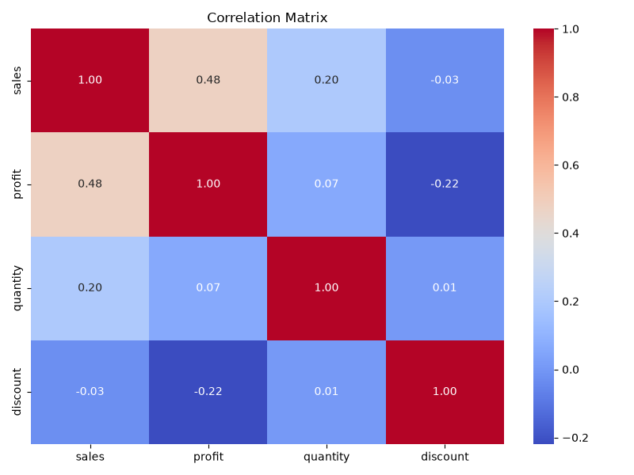
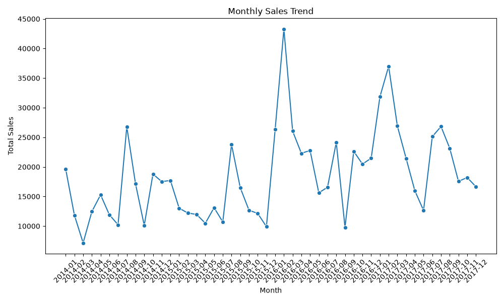
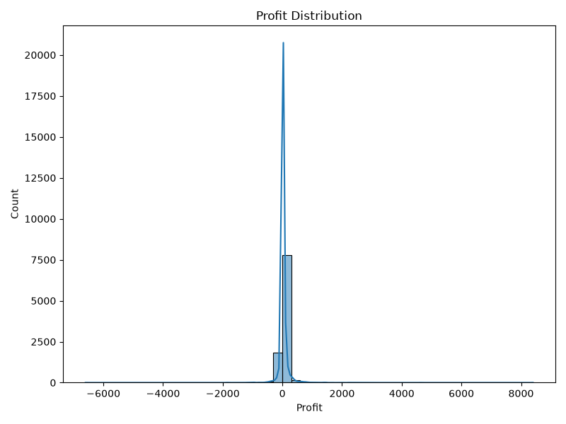
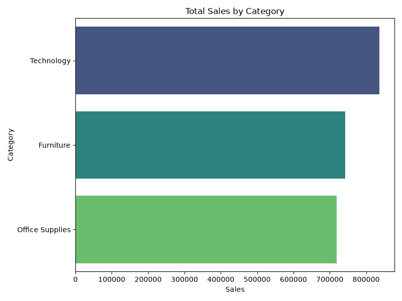

# Advanced Exploratory Data Analysis Report

## Dataset Overview
- Rows: 9994
- Columns: 22
## Correlation Matrix

## Monthly Sales Trend

## Profit Distribution

## Sales by Category

## Top 10 Profitable Products (interactive)
[Interactive Plot](visualizations/top10_profitable_products.html)

---
Generated by advanced_eda.py script.